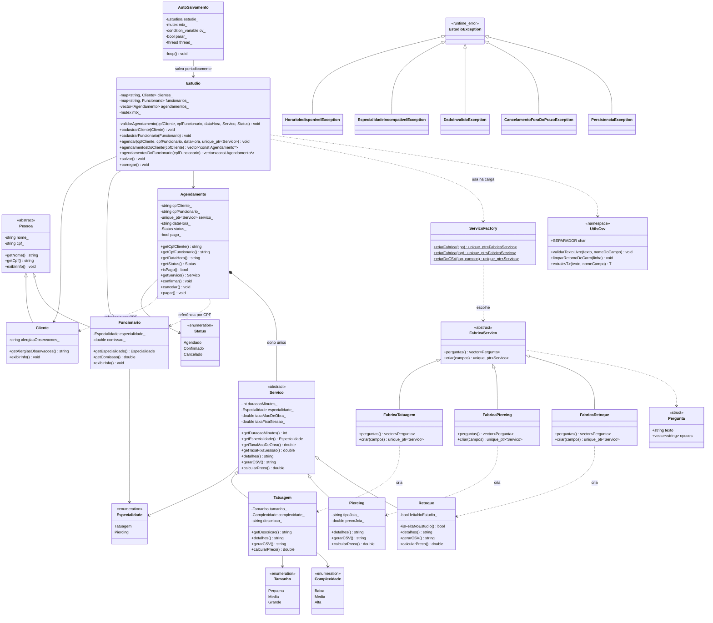

# Estúdio de Tatuagem

Sistema de gerenciamento de um estúdio de tatuagem em C++, com interface em
terminal. Projeto desenvolvido para a disciplina de Programação Orientada a
Objetos (ICMC-USP).

## Uso de IA

Este projeto usa o Claude Code (Anthropic) como ferramenta de apoio. A
implementação do código (classes, lógica e `main`) é feita manualmente pela
dupla; o objetivo da disciplina é aprender, e por isso a IA não escreve o
código-fonte do projeto.

A IA é usada para:

- **Documentação:** edição do README, do diagrama de classes e do registro
  de decisões (`docs/decisoes.md`). Os commits desse tipo trazem a linha
  `Co-Authored-By` no histórico do git.
- **Apoio ao aprendizado:** funciona como tutor, explicando conceitos,
  propondo perguntas e experimentos e discutindo alternativas de design. As
  decisões são tomadas pela dupla.
- **Revisão de código:** apontar problemas e sugerir melhorias no código já
  escrito, que a dupla avalia e aplica por conta própria.

## Requisitos da disciplina

- **Classes**: entidades do domínio (pessoas, serviços, agendamentos, estúdio).
- **Herança**: `Cliente` e `Funcionario` herdando de `Pessoa`; `Tatuagem`,
  `Piercing` e `Retoque` herdando de `Servico`; hierarquia de exceções a
  partir de `EstudioException`.
- **Polimorfismo**: métodos virtuais puros `exibirInfo()` (em `Pessoa`) e
  `calcularPreco()` (em `Servico`), usados por meio de
  `std::unique_ptr<Servico>` no `Agendamento`, que é o único dono do
  serviço.
- **Tratamento de erros com exceções**: hierarquia própria de exceções
  derivada de `std::runtime_error`.

Segunda etapa:

- **Persistência de dados**: clientes, funcionários e agendamentos são
  gravados em arquivos CSV na pasta `dados/` e carregados ao iniciar
  (entradas 18 a 24 de [`docs/decisoes.md`](docs/decisoes.md)).
- **Threads**: a classe `AutoSalvamento` mantém uma `std::thread` que salva
  os dados a cada 30 segundos. O `Estudio` é protegido por um `std::mutex`
  (entradas 25 a 28).
- **Tipos genéricos (templates)**: `UtilsCsv::extrair<T>` lê qualquer tipo
  numérico de um campo do CSV com um único corpo, e um `static_assert`
  recusa tipos não numéricos em tempo de compilação (entrada 29).
- **Coleções**: `std::map` (clientes e funcionários indexados pelo CPF) e
  `std::vector` (agendamentos e campos lidos do CSV), da biblioteca padrão.
- **Padrão de projeto (Factory Method)**: a classe abstrata `FabricaServico`
  declara `perguntas()` e `criar()`, e `FabricaTatuagem`, `FabricaPiercing`
  e `FabricaRetoque` os sobrescrevem para criar cada tipo de `Servico`. O
  menu faz as perguntas que a fábrica informa num laço único, sem `if` por
  tipo, e a carga do CSV usa as mesmas fábricas (entrada 30).

Todas as classes do diagrama estão implementadas: as hierarquias de
`Servico`, `Pessoa` e de exceções, o `Agendamento`, o `Estudio`, a
persistência, o auto-save e o menu interativo em `src/main.cpp`. O menu
permite cadastrar clientes e funcionários, agendar serviços e listar os
agendamentos de um cliente ou de um funcionário. Mudar o estado de um
agendamento (confirmar, cancelar, pagar) pelo menu está fora do escopo da
entrega atual (ver entrada 17). O diagrama abaixo reflete o código atual, e
as justificativas de design estão no registro de decisões.

## Diagrama de classes



## Como compilar e rodar

Requisitos: Linux (ou WSL no Windows), `g++` com suporte a C++17 e `make`.
O projeto usa `<filesystem>` e `<thread>`, que o MinGW 6.3 do Windows não
oferece. O `Makefile` já passa `-pthread` ao compilador.

O `make` gera o executável em `build/estudio-tatuagem`, e o `make run`
compila e abre o menu interativo no terminal.

```bash
make
```

```bash
make run
```

Para limpar os artefatos de build:

```bash
make clean
```

### Dados salvos

Os dados ficam em `dados/clientes.csv`, `dados/funcionarios.csv` e
`dados/agendamentos.csv`, criados na pasta em que o programa é executado.
Eles são carregados ao abrir o programa, salvos a cada 30 segundos pelo
auto-save e salvos de novo ao sair pela opção 0. Se um arquivo estiver
corrompido, o programa mostra o arquivo e a linha do erro e encerra sem
salvar, para não sobrescrever os dados.

## Estrutura de pastas

```
estudio-tatuagem/
├── include/     # Headers (.hpp) com as declarações das classes
├── src/         # Implementações (.cpp) e main.cpp
├── docs/        # Registro de decisões de design (decisoes.md)
├── build/       # Artefatos de compilação (gerado pelo make, ignorado pelo git)
├── dados/       # Arquivos CSV com os dados salvos (gerado pelo programa, ignorado pelo git)
├── Makefile
├── .gitignore
└── README.md
```

## Fluxo de trabalho com Git

Regras da dupla:

1. A branch `main` deve **sempre compilar** (`make` sem erros).
2. Toda mudança é feita em uma branch própria, criada a partir da `main`
   atualizada, nomeada seguindo [Conventional Commits](https://www.conventionalcommits.org/):
   `<tipo>/<descricao-curta>`, por exemplo `feat/cadastro-cliente`,
   `fix/calculo-preco-tatuagem`, `docs/atualizar-readme`.
   Tipos mais usados:
   - `feat/` — nova funcionalidade
   - `fix/` — correção de bug
   - `refactor/` — refatoração sem mudança de comportamento
   - `docs/` — documentação
   - `test/` — testes
   - `chore/` — tarefas de manutenção (build, configs, etc.)
3. As mensagens de commit também devem seguir Conventional Commits:
   `<tipo>: <descrição>` (ex.: `feat: adiciona cadastro de cliente`).
4. Ao terminar, abra um Pull Request para a `main`. **O outro integrante deve
   revisar antes do merge.**
5. Antes de começar algo novo, sempre atualize sua `main` local com
   `git pull`.

### Comandos básicos (para quem tem pouca experiência com git)

Atualizar a `main` local antes de começar algo novo:

```bash
git checkout main
git pull
```

Criar uma branch a partir da main atualizada, usando o padrão
`<tipo>/<descricao-curta>`:

```bash
git checkout -b feat/nome-da-feature
```

Ver o que foi alterado:

```bash
git status
git diff
```

Adicionar e commitar as mudanças:

```bash
git add .
git commit -m "feat: descrição clara da mudança"
```

Enviar a branch para o GitHub:

```bash
git push -u origin feat/nome-da-feature
```

Depois disso, abra o Pull Request na interface do GitHub (ou com
`gh pr create`), peça revisão do colega e só então faça o merge para a
`main`.

Após o merge, volte para a main e atualize antes de começar a próxima tarefa:

```bash
git checkout main
git pull
```

## Divisão de tarefas

| Tarefa | Responsável |
|--------|-------------|
| `Servico` → `Tatuagem`, `Piercing`, `Retoque` | Luís |
| `Pessoa` → `Cliente`, `Funcionario` | Miguel |
| `Agendamento` | Luís |
| Exceções (`EstudioException` e derivadas) | Luís |
| `Estudio` e menu | Miguel |
| Persistência em CSV | Miguel |
| Auto-save (thread e mutex) | Miguel |
| Template `extrair<T>` | Miguel |
| Factory Method (fábricas de serviço) | Miguel |

## Autores

- Luís Filipe Vasconcelos Peres
- Miguel Lima
